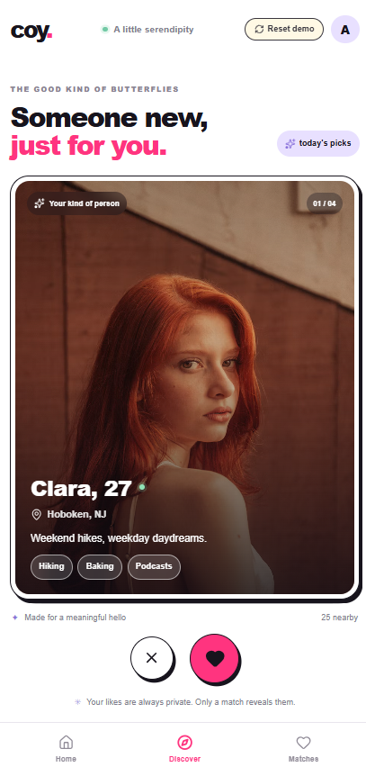
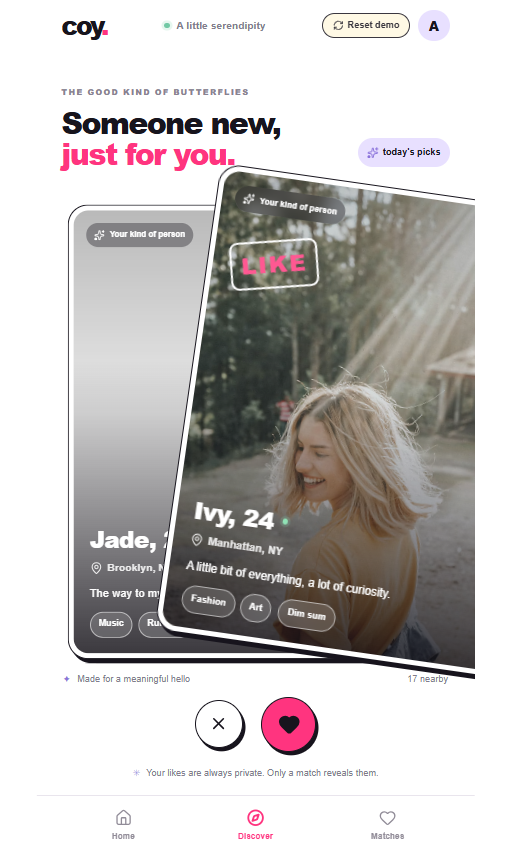
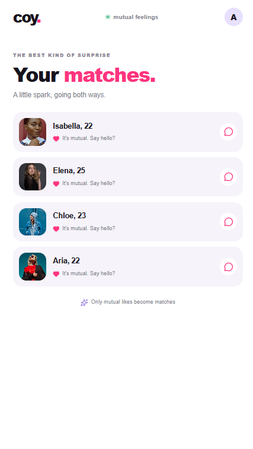

# Coy Discover

A full-stack dating app discovery feature built as part of a technical assignment. Explore profiles, swipe to like or pass, discover mutual matches, and manage your connections with data stored persistently in SQLite.

---

## Features

- **Swipe cards** - drag right to like, drag left to pass, or use the action buttons
- **Mutual matching** - a match is only created when both users like each other
- **Private likes** - one-sided likes are never exposed through any API response
- **Persistent data** - swipes and matches survive page refreshes and server restarts
- **Match celebration** - animated overlay appears when a mutual match occurs
- **Matches page** - browse all confirmed matches with profile details
- **Demo reset** - one-click reset in development to restore the original seeded state

---

## Screenshots

### Person's Card


### Sliding Card


### Matched Persons



## Tech Stack

| Layer | Technology |
|---|---|
| Framework | Next.js 16 (App Router) |
| UI | React 19, TypeScript 5 |
| Styling | Tailwind CSS 4, Framer Motion 14 |
| ORM | Prisma 6 |
| Database | SQLite (local file via `prisma/dev.db`) |
| Package manager | pnpm 12 |

---

## How It Works

1. The app runs as a single demo user (Alex, `demo-user-01`). There is no login.
2. `GET /api/feed` returns all profiles Alex has not yet swiped on.
3. Swiping right (or clicking the heart button) sends `POST /api/swipe` with `action: "LIKE"`.
4. Swiping left (or clicking the X button) sends `POST /api/swipe` with `action: "PASS"`.
5. After recording the swipe, the API checks whether the target user has already liked Alex. If so, a Match row is created and `isMatch: true` is returned.
6. The match celebration overlay appears immediately. The Matches page reflects the new match on next load.
7. `hasLikedMe` is always `false` in every API response. No endpoint reveals one-sided incoming likes.

---

## Project Structure

```
project/
├── prisma/
│   ├── schema.prisma          # Database schema (User, Swipe, Match)
│   ├── seed.ts                # Seed script: demo user + 30 profiles + 7 incoming likes
│   ├── test-logic.js          # Logic and edge-case tests (run with node)
│   └── migrations/            # Prisma migration history
├── src/
│   ├── app/
│   │   ├── api/
│   │   │   ├── feed/route.ts       # GET /api/feed
│   │   │   ├── swipe/route.ts      # POST /api/swipe
│   │   │   ├── matches/route.ts    # GET /api/matches
│   │   │   └── dev/reset/route.ts  # POST /api/dev/reset (development only)
│   │   ├── discover/page.tsx   # Discover page
│   │   ├── matches/page.tsx    # Matches page
│   │   └── home/page.tsx       # Home page
│   ├── components/
│   │   ├── DiscoverApp.tsx     # Main swipe UI with match celebration overlay
│   │   ├── ProfileCard.tsx     # Draggable swipe card (Framer Motion)
│   │   ├── ResetDemoButton.tsx # Dev-only reset button
│   │   └── BottomNavigation.tsx
│   ├── services/
│   │   ├── feedService.ts      # Calls GET /api/feed
│   │   ├── swipeService.ts     # Calls POST /api/swipe
│   │   └── matchService.ts     # Calls GET /api/matches
│   ├── lib/
│   │   └── db.ts               # Prisma client singleton
│   └── types/
│       └── index.ts            # Shared TypeScript types
└── package.json
```

---

## Installation

### Prerequisites

- Node.js 18+
- pnpm (`npm install -g pnpm`)

### Install dependencies

```bash
pnpm install
```

---

## Environment Variables

A `.env` file is already included in the project root:

```
DATABASE_URL="file:./dev.db"
```

This tells Prisma to create the SQLite database at `prisma/dev.db`. Do not change this path unless you also update the schema.

---

## Database Setup

Run migrations and seed the database:

```bash
pnpm db:migrate
```

This applies the schema migrations and seeds 31 users (1 demo user + 30 profiles) and 7 pre-seeded incoming likes.

To reset and reseed from scratch:

```bash
pnpm db:reset
```

---

## Running the App

```bash
pnpm dev
```

Open [http://localhost:3000](http://localhost:3000).

For a production build:

```bash
pnpm build
pnpm start
```

---

## Available Scripts

| Script | Description |
|---|---|
| `pnpm dev` | Start the development server |
| `pnpm build` | Build for production |
| `pnpm start` | Start the production server |
| `pnpm db:migrate` | Apply migrations and seed the database |
| `pnpm db:seed` | Run the seed script only |
| `pnpm db:reset` | Reset database and reseed from scratch |
| `pnpm db:generate` | Regenerate Prisma client after schema changes |
| `pnpm db:studio` | Open Prisma Studio (visual database browser) |

---

## API Reference

### GET /api/feed

Returns all profiles that the demo user has not yet swiped on.

**Response:**
```json
{
  "profiles": [
    {
      "id": "profile-01",
      "name": "Maya",
      "age": 24,
      "location": "Brooklyn, NY",
      "bio": "Collecting little moments and very big playlists.",
      "photo": "https://images.unsplash.com/...",
      "interests": ["Film photos", "Sunday markets", "Indie music"],
      "hasLikedMe": false
    }
  ]
}
```

---

### POST /api/swipe

Records a swipe and creates a Match if both users have liked each other.

**Request body:**
```json
{ "targetUserId": "profile-01", "action": "LIKE" }
```

`action` must be `"LIKE"` or `"PASS"`.

**Response (no match):**
```json
{ "success": true, "isMatch": false }
```

**Response (mutual match):**
```json
{
  "success": true,
  "isMatch": true,
  "matchedProfile": { "id": "profile-01", "name": "Maya", ... }
}
```

**Error responses:**

| Status | Reason |
|---|---|
| 400 | Missing or invalid fields, or swiping on yourself |
| 404 | Profile not found |
| 409 | Already swiped on this profile |

---

### GET /api/matches

Returns all confirmed mutual matches for the demo user.

**Response:**
```json
[
  {
    "id": "match-id",
    "matchedAt": "2026-11-18T17:30:00.000Z",
    "profile": { "id": "profile-01", "name": "Maya", ... }
  }
]
```

---

### POST /api/dev/reset

Clears all swipes and matches for the demo user and restores the original seeded incoming likes. Returns `403` outside of development.

---

## Demo

The app is pre-seeded with 30 profiles. Seven of them have already liked Alex, so swiping LIKE on any of them triggers an instant match:

| Profile | Swipe LIKE to get a match |
|---|---|
| Maya | yes |
| Isabella | yes |
| Chloe | yes |
| Lily | yes |
| Aria | yes |
| Jade | yes |
| Elena | yes |

All other profiles will record a one-sided like with no match shown.

In development, use the **Reset demo** button in the top bar to clear all swipes and matches and start over.

---

## Privacy Design

- `hasLikedMe` is always `false` in every API response.
- No endpoint reveals who has liked the demo user.
- The demo user ID is a server-side constant and is never read from the client request.
- A match (and therefore mutual interest) is revealed only at the moment both users have liked each other, via `isMatch: true` in the swipe response.
